<p align="center">
  <a href="https://cctvexpress.stream.builders"></a>
</p>

<p align="center">
  <a href="https://cctvexpress.stream.builders">
    
  </a>
</p>

<p align="center">
  <a href="https://github.com/Stream-Builders/sb-cctv-express/releases/latest"></a>
  <a href="https://cctvexpress.stream.builders"></a>
  <a href="LICENSE"></a>
  
  
</p>

<p align="center">
  
  
  
  
  
</p>

---

##  What it is

IP camera (CCTV) monitoring for Windows, by **Stream.Builders**. Each camera's state is always visible in large,
colored badges: **live**, **connecting**, **no signal**, **recording** (the badge only lights up while the file is
actually growing on disk) and **motion**. Everything runs on your computer: video goes from the camera to your disk
without passing through anyone's server.

###  [Download for Windows](https://github.com/Stream-Builders/sb-cctv-express/releases/latest) &nbsp;·&nbsp;  [cctvexpress.stream.builders](https://cctvexpress.stream.builders)

---

##  Features

- **Live grid:** 1, 4, 9, 16, 25 or 36 cameras, automatic reconnection, double-click full screen, no re-encoding.
- **Continuous recording:** to `C:\cctv_express\records`, in 120-minute segments (adjustable), with retention by days and by free space.
- **Playback:** a daily timeline with motion markers; set a start and end and export the clip as MP4.
- **PTZ and light:** pan, tilt and zoom by holding the button; saved positions and tour; smart, color, infrared or always-on light.
- **Dual-lens cameras:** the second lens is added on its own; click the fixed lens to aim the PTZ lens.
- **Camera settings:** image mode (auto, color, black and white), people-only detection, person tracking, light duration and brightness, siren.
- **Motion detection:** adjustable sensitivity, on-screen badge, timeline marker and Windows notification.
- **Camera discovery:** ONVIF (WS-Discovery), RTSP and Xiongmai/iCSee/XMeye on your network.
- **Automatic compatibility:** cameras with an H.264 profile the browser rejects are transcoded on the fly (on the GPU, when available).
- **18 languages**, following the Windows language.

---

##  How it works

| Part | Role |
|---|---|
| **Electron** | The app window (Windows; Mac later). |
| **go2rtc** (MIT) | Hidden video engine, bound to `127.0.0.1` only: connects to the cameras, reconnects on its own and delivers live video over WebSocket. |
| **FFmpeg** | Recording to fragmented MP4 without re-encoding, motion detection (`scene` filter) and clip export. |
| **ONVIF / DVRIP** | PTZ and light: Xiongmai through its own protocol (port 34567), other brands through ONVIF. |
| **three.js** | The 3D sign on the splash screen and the website. |

- **Cameras** are stored in `cameras.json` in the app's data folder. Passwords are encrypted by Windows (safeStorage/DPAPI)
  and reach go2rtc only through environment variables, never in a plain file.
- **Look:** the colors and the `.sb-btn` component of the ebooks.express tenant (`src/ui/tema/`, from `@ebx/temas`).

---

##  Development

```bash
npm install      # downloads the pinned go2rtc and ffmpeg and copies three.js
npm start        # opens the app
npm run dist     # builds dist/CCTV Express Setup <version>.exe (NSIS, Windows x64)
```

- **Sign as video:** `electron scripts/gravar-letreiro.js midia` renders `midia/letreiro.mp4` and `midia/letreiro.gif`.
- **Website:** `site/` is the landing page at [cctvexpress.stream.builders](https://cctvexpress.stream.builders) (Vercel,
  project `cctvexpress`). Before deploying, run `node scripts/montar-site.mjs`; then `npx vercel deploy --prod --yes` inside `site/`.

---

##  Roadmap

- [x] Live grid with automatic reconnection and visible state
- [x] Continuous recording to disk, with retention by days and free space
- [x] Network camera discovery, 18 languages, settings and 3D splash
- [x] Playback with timeline and clip export
- [x] PTZ and light (Xiongmai and ONVIF)
- [x] Motion detection and alerts
- [x] Windows installer
- [ ] Browser interface on the local network (phones and other computers at home)

---

##  License

MIT. See [LICENSE](LICENSE). The app uses go2rtc (MIT), three.js (MIT) and FFmpeg (LGPL/GPL, downloaded at install time).

<p align="center">
  <a href="https://cctvexpress.stream.builders"></a>
</p>

<p align="center">
  <a href="https://stream.builders"></a>
</p>
