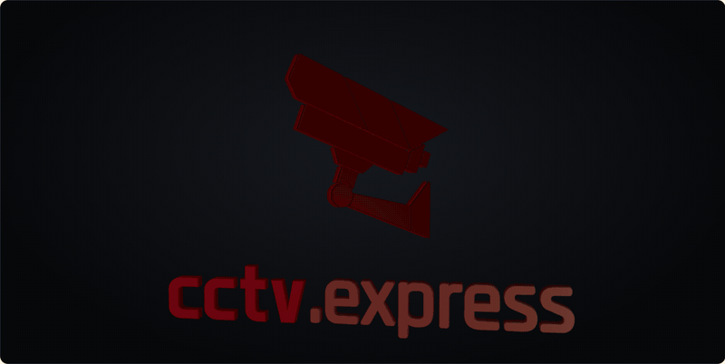

<p align="center">
  
</p>

<p align="center">
  <a href="https://cctvexpress.stream.builders">
    
  </a>
</p>

<p align="center">
  <a href="https://github.com/Stream-Builders/sb-cctv-express/releases/latest"></a>
  <a href="https://cctvexpress.stream.builders"></a>
  <a href="LICENSE"></a>
  
  
</p>

<p align="center">
  
  
  
  
  
</p>

---

## 🎥 O que é

Monitoramento de câmeras IP (CCTV) para Windows, da **Stream.Builders**. O estado de cada câmera fica sempre visível, em
selos grandes e coloridos: **ao vivo**, **conectando**, **sem sinal**, **gravando** (o selo só acende quando o arquivo
está crescendo no disco) e **movimento**. Tudo roda no seu computador: o vídeo vai da câmera para o seu disco, sem
passar por servidor de ninguém.

### ⬇️ [Baixar para Windows](https://github.com/Stream-Builders/sb-cctv-express/releases/latest) · 🌐 [cctvexpress.stream.builders](https://cctvexpress.stream.builders)

---

## ✨ Recursos

- **Ao vivo em mosaico:** 1, 4, 9, 16, 25 ou 36 câmeras, reconexão automática, tela cheia com dois cliques, sem recomprimir.
- **Gravação contínua:** em `C:\cctv_express\records`, blocos de 120 minutos (ajustáveis), retenção por dias e por espaço livre.
- **Reprodução:** linha do tempo do dia com as marcas de movimento; marque início e fim e exporte o trecho em MP4.
- **PTZ e luz:** mova e aproxime segurando o botão; luz inteligente, colorida, infravermelho ou sempre acesa.
- **Detecção de movimento:** sensibilidade ajustável, selo na tela, marca na linha do tempo e aviso do Windows.
- **Encontra as câmeras:** ONVIF (WS-Discovery), RTSP e Xiongmai/iCSee/XMeye na sua rede.
- **Compatibilidade automática:** câmera com perfil H264 que o navegador recusa passa a ser reconvertida (com a placa de vídeo, se houver).
- **18 idiomas**, seguindo o idioma do Windows.

---

## 🛠️ Como funciona

| Peça | Papel |
|---|---|
| **Electron** | A janela do app (Windows; Mac depois). |
| **go2rtc** (MIT) | Motor de vídeo escondido, só em `127.0.0.1`: conecta nas câmeras, reconecta sozinho e entrega o vídeo ao vivo por WebSocket. |
| **FFmpeg** | Gravação em MP4 fragmentado sem recomprimir, detecção de movimento (filtro `scene`) e exportação de trechos. |
| **ONVIF / DVRIP** | PTZ e luz: Xiongmai pelo protocolo próprio (porta 34567), as demais marcas por ONVIF. |
| **three.js** | O letreiro 3D do splash e do site. |

- **Câmeras** ficam em `cameras.json` na pasta de dados do app. A senha é cifrada pelo Windows (safeStorage/DPAPI) e chega
  ao go2rtc só por variável de ambiente, nunca em arquivo aberto.
- **Visual:** as cores e a peça `.sb-btn` do tenant ebooks.express (`src/ui/tema/`, da `@ebx/temas`).

---

## 🚀 Desenvolvimento

```bash
npm install      # baixa o go2rtc e o ffmpeg nas versões fixadas e copia o three.js
npm start        # abre o app
npm run dist     # gera dist/CCTV Express Setup <versão>.exe (NSIS, Windows x64)
```

- **Letreiro em vídeo:** `electron scripts/gravar-letreiro.js midia` gera `midia/letreiro.mp4` e `midia/letreiro.gif`.
- **Site:** `site/` é a landing de [cctvexpress.stream.builders](https://cctvexpress.stream.builders) (Vercel, projeto
  `cctvexpress`). Antes do deploy, `node scripts/montar-site.mjs`; depois `npx vercel deploy --prod --yes` dentro de `site/`.

---

## 🗺️ Etapas

- [x] Ao vivo em mosaico com reconexão automática e estado visível
- [x] Gravação contínua em disco, com retenção por dias e espaço livre
- [x] Detecção de câmeras na rede, 18 idiomas, configurações e splash 3D
- [x] Reprodução com linha do tempo e exportação de trechos
- [x] PTZ e luz (Xiongmai e ONVIF)
- [x] Detecção de movimento e alertas
- [x] Instalador para Windows
- [ ] Interface pelo navegador na rede local (celular e outros computadores da casa)

---

## 📄 Licença

MIT. Veja [LICENSE](LICENSE). O app usa go2rtc (MIT), three.js (MIT) e FFmpeg (LGPL/GPL, baixado na instalação).

<p align="center">
  <a href="https://stream.builders"></a>
</p>
